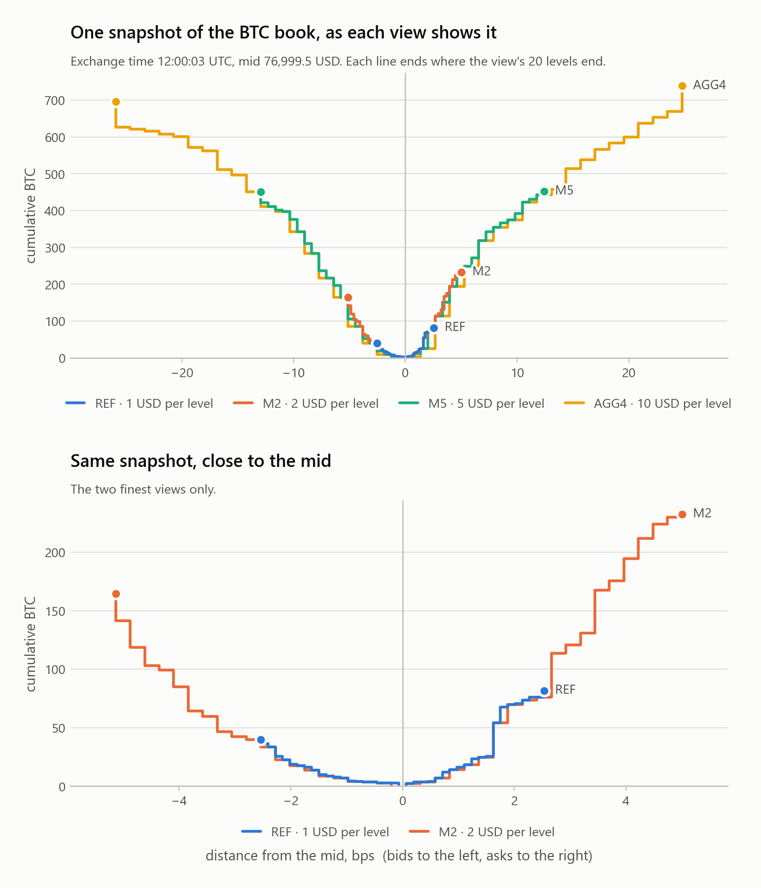
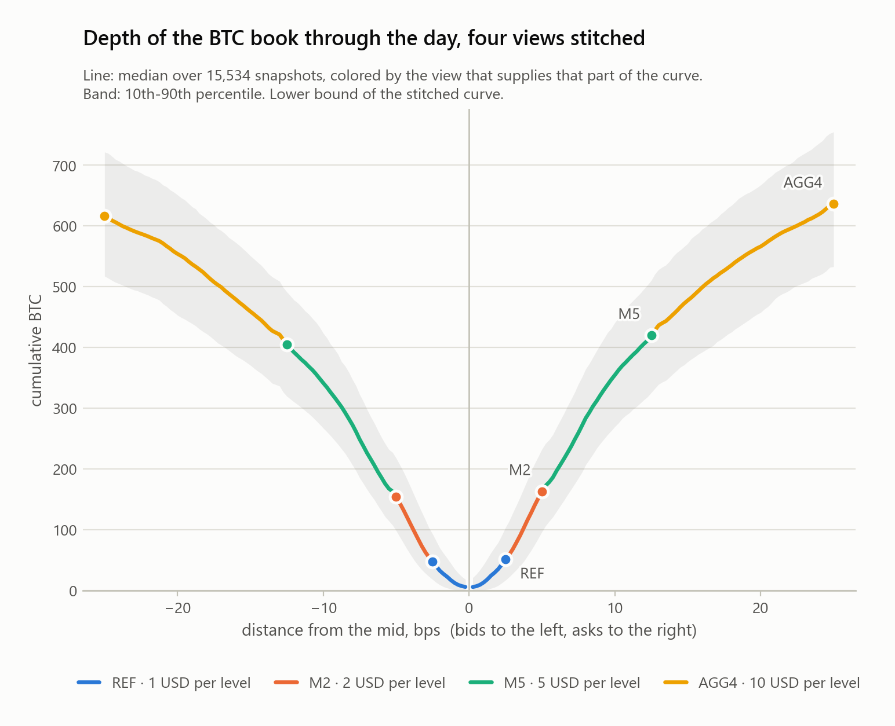
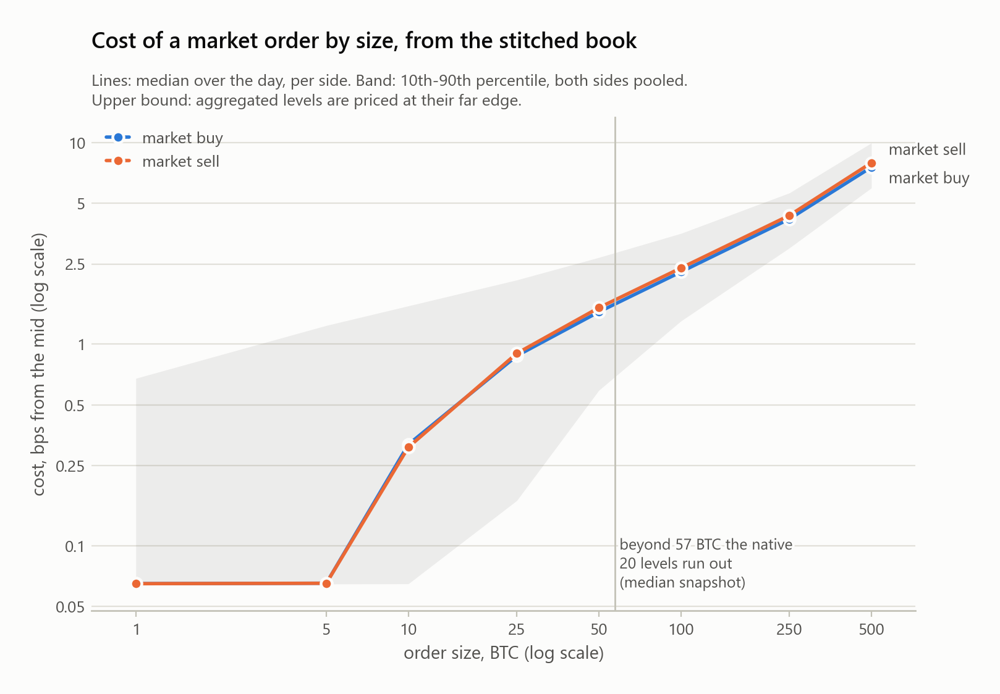
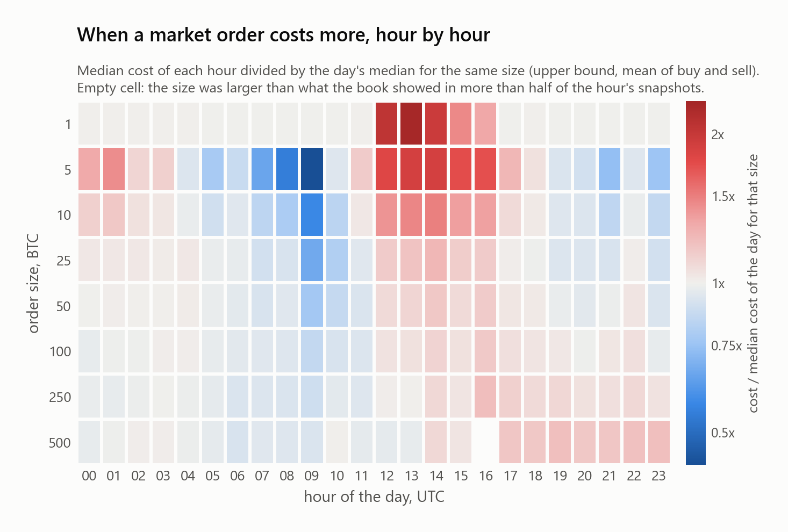
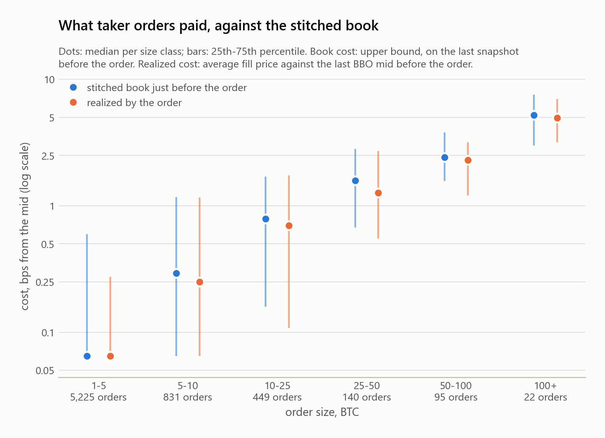

# Hyperliquid L2 notebooks

Reproducible analyses of the free 24-hour sample of the [HyperNatt Hyperliquid L2 archive](https://hypernatt.com/datasets).

## The BTC order book at four resolutions

Notebook: [`notebooks/four_resolutions.ipynb`](notebooks/four_resolutions.ipynb)

Hyperliquid's public `l2Book` stream returns 20 price levels per side, on the native price step or on a coarser
price grid. The archive records four of these views side by side. The notebook measures what each view shows,
checks that the four views describe the same book, stitches them into one depth curve, prices market orders on
that curve and compares the result with the taker orders executed that day.

It describes one day of data (2026-09-11, BTC). It is not trading advice.



### Results on the sample day

Every figure below is copied from `results/summary.json`, which the notebook writes.

**What each view shows** (medians over the day)

| View | Price step, USD | Reach from the mid, bps | BTC on the bid side | BTC on the ask side |
|---|---|---|---|---|
| `REF` | 1 | 2.7 | 55 | 60 |
| `M2` | 2 | 5.1 | 163 | 174 |
| `M5` | 5 | 12.6 | 420 | 436 |
| `AGG4` | 10 | 25.3 | 641 | 656 |

**Do the views agree?** On snapshots that carry the same exchange time, 908,878 of
908,878 aggregated levels hold exactly the sum of the finer levels that fall into them
(largest gap: 0 BTC). 15,534 snapshots carry the same
exchange time in the four views (96.5 % of the snapshots of a view).

**One depth curve.** Stitched, the four views show 11.1 times
the BTC of the native view and reach 9.5 times farther from
the mid (median snapshot).



**Cost of a market order** (bps from the mid, median over the day, low - high bound) and how often each size can
be priced at all

| Order size | Buy | Sell | Priceable, four views | Priceable, native view alone |
|---|---|---|---|---|
| 1 BTC | 0.065 - 0.065 | 0.065 - 0.065 | 100.0 % | 100.0 % |
| 5 BTC | 0.065 - 0.065 | 0.065 - 0.065 | 100.0 % | 99.8 % |
| 10 BTC | 0.318 - 0.318 | 0.308 - 0.308 | 100.0 % | 99.5 % |
| 25 BTC | 0.876 - 0.876 | 0.900 - 0.900 | 100.0 % | 94.6 % |
| 50 BTC | 1.445 - 1.446 | 1.514 - 1.516 | 100.0 % | 61.8 % |
| 100 BTC | 2.234 - 2.283 | 2.332 - 2.387 | 100.0 % | 12.9 % |
| 250 BTC | 3.973 - 4.180 | 4.131 - 4.352 | 99.9 % | 0.2 % |
| 500 BTC | 7.129 - 7.552 | 7.483 - 7.943 | 95.9 % | 0.0 % |





**The orders that were executed.** 122,092 taker orders (fills that share a transaction hash
and a side) traded on the sample day; 6,762 of them were of at least 1 BTC and
carried 81.4 % of the BTC traded. The notebook
compares what these orders paid with the cost of the same sizes on the stitched book just before them.



Definitions, tables and limits are in the notebook.

## Run it

```bash
python -m venv .venv
.venv/bin/pip install -r requirements-dev.txt        # Windows: .venv\Scripts\pip
.venv/bin/python tools/run_notebook.py --check       # executes the notebook, compares results/summary.json
.venv/bin/python -m pytest -q                        # unit tests on hand-made books
```

The notebook downloads the sample (88,487,924 bytes) from hypernatt.com, with Hugging Face and Zenodo as
fallbacks, and stops if its SHA-256 differs from the one published in
[`release.json`](https://hypernatt.com/datasets/release.json). Dependencies: numpy, pandas and matplotlib, with
exact versions in `requirements.txt`.

## Data

| | |
|---|---|
| File | `HYPERNATT_HL_L2_BTC_SAMPLE_20260911.zip` |
| SHA-256 | `128aa6beaff2aa294a3d711f810744977c46ee2eac4c1d9f9f80405e0c24df03` |
| DOI | [10.5281/zenodo.24151403](https://doi.org/10.5281/zenodo.24151403) |
| Licence of the sample | CC-BY-4.0 (attribution terms in `LICENSE.txt` inside the archive) |
| Release | 20261110 |

The full archive has the same format for BTC and ETH: <https://hypernatt.com/datasets>.

## Repository

| Path | Content |
|---|---|
| `notebooks/four_resolutions.ipynb` | the notebook, executed, with its tables and figures |
| `hlbook.py` | download and SHA-256 check, readers, cross-check, stitched depth curve, cost of an order |
| `hlplots.py` | the figures |
| `tests/` | unit tests |
| `results/` | `summary.json` and the figures written by the notebook |
| `tools/` | `run_notebook.py`, `render_readme.py` |

## Licence

Code: MIT (see `LICENSE`). Sample data: CC-BY-4.0.
